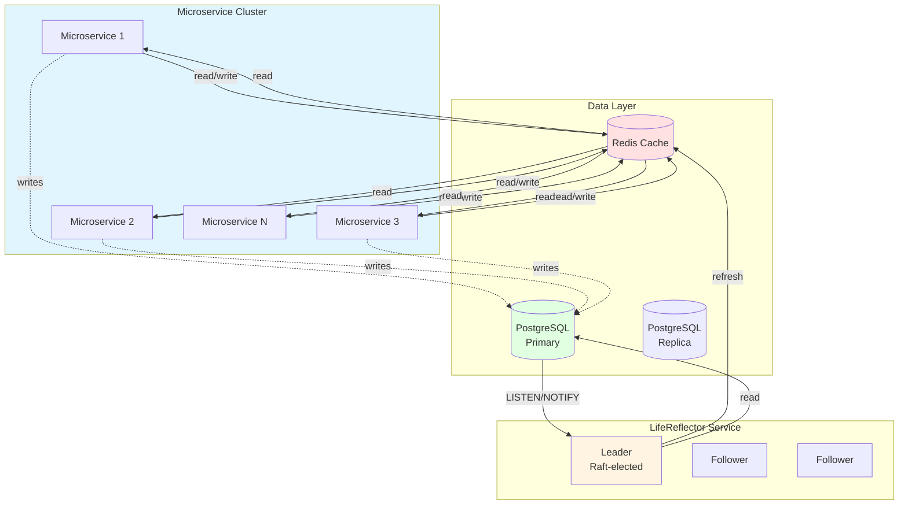

# Vision: what we’re building

This document is the **long-form product vision**: core ORM abstractions, pooling, **LifeReflector**, transparent caching targets, replica routing, and parity lists (shipped vs planned). For **what compiles today**, repository truth, and competitive framing, see **[COMPARISON.md](./COMPARISON.md)** (start with [repository status](./COMPARISON.md#repository-status)) and [SEAORM_LIFEGUARD_MAPPING.md](./docs/planning/lifeguard-derive/SEAORM_LIFEGUARD_MAPPING.md).

---

## 🚀 What we're building

### Core ORM: LifeModel & LifeRecord

A complete ORM system with two primary abstractions:

**LifeModel** (Immutable Database Rows)
- Represents database rows as immutable Rust structs
- Generated via `#[derive(LifeModel)]` procedural macro
- Provides type-safe query builders
- Automatic row-to-struct mapping
- Complete SeaORM API parity

**LifeRecord** (Mutable Change Sets)
- Separate abstraction for inserts and updates
- Generated via `#[derive(LifeRecord)]` procedural macro
- Type-safe mutation builders
- Automatic SQL generation via SeaQuery
- Change tracking (dirty fields)

```rust
use lifeguard_derive::{LifeModel, LifeRecord};

#[derive(LifeModel, LifeRecord)]
#[table_name = "users"]
struct User {
    #[primary_key]
    id: i64,
    email: String,
    is_active: bool,
}

// Inserts/selects go through LifeExecutor + SelectQuery / ActiveModelTrait;
// see lifeguard-derive tests and examples/ for full patterns (no Tokio required).
```

### Connection pool: LifeguardPool

**In-tree:** [`LifeguardPool`](./src/pool/pooled.rs) (re-exported as `lifeguard::LifeguardPool`) — persistent `may_postgres` connections, one worker per slot, bounded per-worker job queues, configurable acquire timeout ([`LifeError::PoolAcquireTimeout`](./src/executor.rs)), optional read-replica routing with [`WalLagMonitor`](./src/pool/wal.rs), slot heal, idle liveness, max connection lifetime, and Prometheus metrics with a low-cardinality **`pool_tier`** label (`primary` / `replica`) on pool-scoped series. See [POOLING_OPERATIONS.md](./docs/POOLING_OPERATIONS.md), [DESIGN_CONNECTION_POOLING.md](./docs/planning/DESIGN_CONNECTION_POOLING.md), and [OBSERVABILITY.md](./OBSERVABILITY.md) (summary) / [docs/OBSERVABILITY.md](./docs/OBSERVABILITY.md) (operators, Kind, metric tables).

**Alternative:** open connections with [`connect`](./src/connection.rs) and run queries through [`MayPostgresExecutor`](./src/executor.rs) / [`LifeExecutor`](./src/executor.rs) when you do not need the pool. See [`examples/query_builder_example.rs`](./examples/query_builder_example.rs) for patterns.

### The Killer Feature: LifeReflector

**Distributed cache coherence system**—this is Lifeguard's unique advantage:

> **Note:** LifeReflector is developed as the **`lifeguard-reflector`** workspace crate in this repository ([`./lifeguard-reflector`](./lifeguard-reflector/)). Enterprise licensing may still apply for some distributions; see that crate’s README.

A **standalone microservice** that maintains cluster-wide cache coherence:

- **Leader-elected system** (target: Raft consensus; shipped: single-node **Redlock** with hot standbys): Only one active reflector at a time (no duplicate work)
- **Postgres LISTEN/NOTIFY integration:** Subscribes to database change events
- **Intelligent cache refresh:** Only **re-writes** keys that already exist in Redis (TTL-based **active set**—no stale copy to fix if the key was never cached)
- **Read path populates Redis:** Cache miss → load from Postgres → `SETEX` (with TTL); new rows enter Redis when something **reads** them (or via warm-up), not from `NOTIFY` alone
- **Horizontal scaling:** All microservices benefit from single reflector

**How it works:**

1. **Reads (population):** A service checks **Redis first**. On a **miss**, it reads from **Postgres** and **writes the row into Redis** (e.g. `SETEX` + TTL). First-time and cold rows are cached here—this is how Redis gets populated.
2. **LifeRecord** (or the writer) commits to **Postgres**; the database path emits **`NOTIFY`** (payload identifies the row).
3. **LifeReflector** (leader) receives the notification.
4. Reflector checks whether that entity **key already exists** in Redis (active cached item).
5. **If it exists** → Reflector **re-reads from Postgres** and **updates Redis** so no client keeps a pre-write value.
6. **If it does not exist** → Reflector **ignores** the notify: there is **no cached row to invalidate**—nothing in Redis was wrong. The next read miss still runs step (1) and loads fresh data from Postgres into Redis.
7. **Cross-service reads:** Once a key is in Redis, other services can read it from Redis; steps 2–6 keep **already-cached** keys aligned with Postgres after writes.

**Target system architecture** — the original sketch, kept as the design north star. The as-built design differs in a few specific ways; see the deltas below and the accurate as-built diagrams in the [`lifeguard-reflector` README](./lifeguard-reflector/README.md):



**Target vs as-built deltas:**

| Aspect | Target (this sketch) | As-built |
|---|---|---|
| Leader election | Raft-elected leader + followers | Single-node Redlock (`SET NX PX` + Lua-CAS renewal); extra instances are hot standbys that sleep and retry |
| Who touches Redis | Microservices read/write Redis directly | Only the ORM (cache-aside `find_by_id`); app code never sees the cache |
| Writes | Dashed secondary edge to Postgres | Always land on the primary (the only write path) and invalidate the cache key |
| Replica | Drawn without edges | Serves pooled miss reads when the tier is healthy; receives streaming replication |

**Result:** Oracle Coherence–style **coherence for the active set** in Redis: lazy (or warmed) population on reads, plus **notify-driven refresh** only where a stale cache entry could otherwise exist. See the **sequence diagram** below (cache miss branch → Postgres → `SETEX`).

**Enterprise:** commercial or source-available licensing may apply for some LifeReflector deployments. Source and package layout live under [`lifeguard-reflector`](./lifeguard-reflector/); contact enterprise@microscaler.io for licensing questions.

### Transparent caching system

**Shipped scope** (as of the current revision): `ModelManager::find_by_id` performs cache-aside reads when the executor exposes a cache provider — opt in via `CachedLifeExecutor` (or `MayPostgresExecutor::with_cache_provider`) + `RedisCacheProvider`. Miss → Postgres → `SETEX`; insert/update/delete invalidate the model key. `lifeguard-reflector` keeps already-cached keys aligned across services after commits.

**Remaining vision** (not wired as “magic” on every read path yet): Lifeguard’s design calls for caching that still respects PostgreSQL primaries and replicas:

- **Check Redis first:** Sub-millisecond reads if cached (shipped for `find_by_id`; other read APIs go straight to the database)
- **Read from replicas:** When healthy (WAL lag < threshold)
- **Write to primary:** Always (as PostgreSQL was designed)
- **LifeReflector keeps cache fresh:** Automatic coherence across microservices ([`lifeguard-reflector`](./lifeguard-reflector/)) — shipped

Your application code doesn't need to know about Redis, replicas, or cache coherence. It just calls `User::find_by_id(&pool, 42)?` and Lifeguard handles the rest.

**Caveats:** the cache-aside path serves integer primary keys named `id` (`find_by_id`'s `i64` signature) and bypasses RLS/session-context filtering — do not combine a cache provider with session-context executors for RLS-protected entities. Cache errors fail open to the database.

**Note:** For distributed cache coherence across multiple microservices, [`lifeguard-reflector`](./lifeguard-reflector/) provides automatic cache refresh using PostgreSQL LISTEN/NOTIFY.

### Replica Read Support

Advanced read routing with WAL lag awareness:

- **WAL position tracking:** Monitors `pg_current_wal_lsn()` vs `pg_last_wal_replay_lsn()`
- **Dynamic health checks:** Automatically detects replica lag
- **Intelligent routing:** Routes reads to replicas only when healthy
- **Automatic fallback:** Falls back to primary if replicas are stale
- **Strong consistency mode:** Optional causal read-your-writes consistency

**Read Preference Modes:**
- `primary` - Always read from primary
- `replica` - Use replicas when healthy
- `mixed` - Automatic selection (Redis → replica → primary)
- `strong` - Causal consistency (wait for replica to catch up)

### Complete feature set (vision vs crate)

The lists below mix **shipped**, **partial**, and **planned** capabilities. For a maintained feature matrix, see [SEAORM_LIFEGUARD_MAPPING.md](./docs/planning/lifeguard-derive/SEAORM_LIFEGUARD_MAPPING.md).

**ORM features (SeaORM parity target):**
- ✅ Complete CRUD operations
- ✅ Type-safe query builders
- ✅ Relations (has_one, has_many, belongs_to, many_to_many)
- ✅ Migrations (programmatic, data seeding, advanced operations)
- ✅ Transactions
- ✅ Raw SQL helpers
- ✅ Batch operations
- ✅ Upsert support
- ✅ Pagination helpers
- ✅ Entity hooks & lifecycle events
- 🟡 Validators (`run_validators` / [`ValidationStrategy`](./src/active_model/validate_op.rs), `ActiveModelBehavior::validate_fields` / `validate_model`, `ActiveModelError::Validation`, derive `#[validate(custom = …)]`, `ValidateOp::Delete`; [`lifeguard::predicates`](./src/active_model/predicates.rs) — `string_utf8_chars_max`, `string_utf8_chars_in_range`, `blob_or_string_byte_len_max`, `i64_in_range`, `f64_in_range`; SeaORM-style built-in attribute matrix not replicated — [PRD §6](./docs/planning/PRD_SCHEMA_VALIDATORS_SESSION_AND_SCOPES.md))
- ✅ Soft deletes
- ✅ Auto-managed timestamps

**Competitive Features:**
- 🟡 Schema inference (`lifeguard-migrate infer-schema`, composite PK `#[primary_key]` codegen, `compare-schema` column drift — [PRD §5](./docs/planning/PRD_SCHEMA_VALIDATORS_SESSION_AND_SCOPES.md))
- 🟡 Session/Unit of Work (`ModelIdentityMap`, `Session` / `SessionDirtyNotifier`, `attach_session` + record auto-dirty enqueue, `flush_dirty` / `flush_dirty_with_map_key`, `register_pending_insert` / `promote_pending_to_loaded` / `is_pending_insert_key`, `flush_dirty_in_transaction` / `flush_dirty_in_transaction_pooled` + `LifeguardPool::exclusive_primary_write_executor`, `LifeRecord::identity_map_key` — [PRD §9](./docs/planning/PRD_SCHEMA_VALIDATORS_SESSION_AND_SCOPES.md))
- 🟡 Scopes (`SelectQuery::scope`, `scope_or` / `scope_any`, `#[scope]` / `#[scope_bundle]` on `impl Entity`; parent scopes are not merged into `find_related`—chain on the returned query — [PRD §7](./docs/planning/PRD_SCHEMA_VALIDATORS_SESSION_AND_SCOPES.md))
- ✅ Model Managers (Django)
- 🟡 F() Expressions (`ColumnTrait::f_*`, `LifeRecord::set_*_expr` / `identity_map_key`, `Expr::expr` in `WHERE`/`ORDER BY`; PostgreSQL applies its own numeric promotion for mixed types—match column/RHS types or use explicit casts when you need a specific storage type; [PRD §8](./docs/planning/PRD_SCHEMA_VALIDATORS_SESSION_AND_SCOPES.md))
- ✅ Advanced eager loading strategies (SQLAlchemy)

**Unique Features (No Other ORM Has):**
- ✅ **LifeReflector** - Distributed cache coherence
- ✅ **Coroutine-native** - No async overhead
- ✅ **WAL-based replica routing** - Automatic health monitoring
- ✅ **TTL-based active set** - Adaptive caching

---

[← README](./README.md) · [Architecture](./ARCHITECTURE.md)
